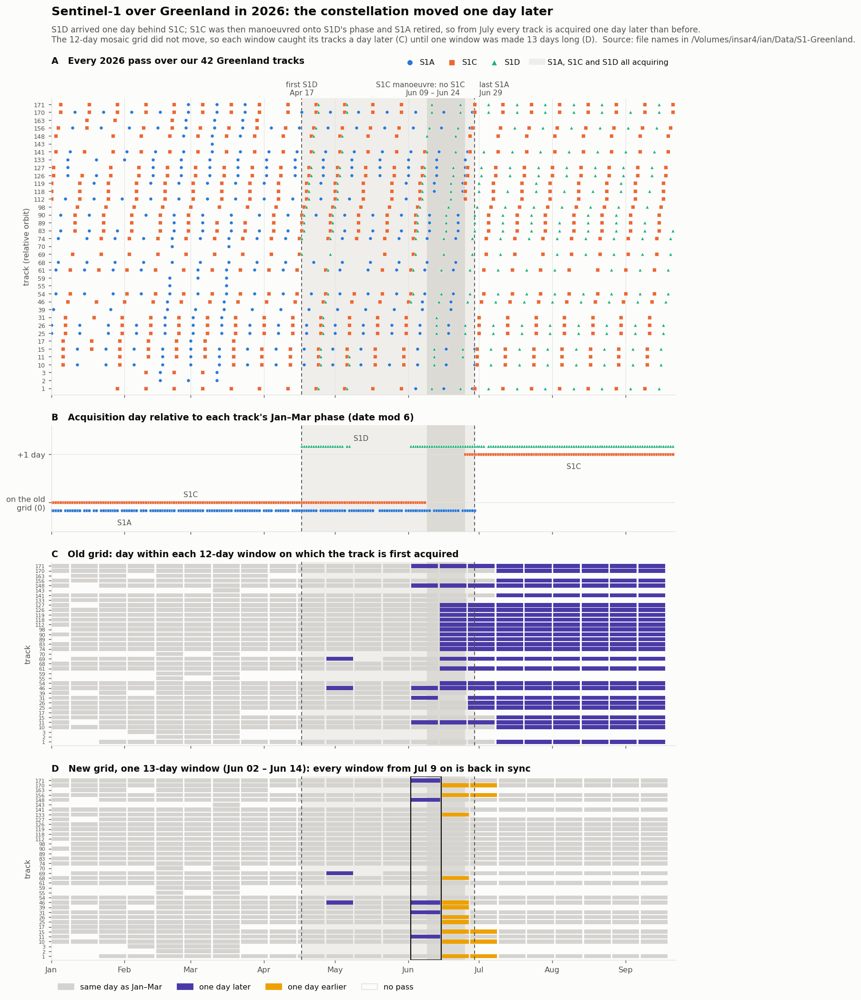

# The 2026 Sentinel-1 phase shift and the mosaic date grid

In June 2026 the Sentinel-1 constellation started acquiring every Greenland
track **one day later** than before. The standard mosaic date grid
(`mosaicfunc.standardDates`) is a fixed arithmetic chain, so without a
correction every 12-day (or 6-day) window from then on caught its tracks a
day later than the same window did earlier in the year. The fix makes **one**
window a day longer: 13 days in the 12-day chain, 7 days in the 6-day chain,
starting **2026-06-02**. Every window from **2026-07-09** on is back in sync.



Regenerate the figure with
`python3 Documents/figures/s1PhaseShift2026.py --out Documents/figures/s1PhaseShift2026.png`
(it reads only the file names in the insar4 S1 archive).

---

## What happened

All dates below are measured from the insar4 archive file names
(`/Volumes/insar4/ian/Data/S1-Greenland`) over the 42 tracks in the insar9 and
insar10 `Sentinel1` projects.

| date | event |
|---|---|
| to mid-April | S1A and S1C interleaved 6 days apart, on the long-standing phase |
| **Apr 17** | first S1D pass, flying **one day behind S1C** |
| Apr 17 – Jun 29 | all three satellites acquiring (the overlap) |
| **Jun 9 – Jun 24** | **no S1C passes**: S1C manoeuvre. It changed orbital slot at absolute orbit 8018 (last pass before, Jun 8; first after, Jun 25) |
| Jun 25 on | S1C back, now on S1D's phase |
| **Jun 29** | last S1A pass (retirement) |
| July on | S1C and S1D interleaved 6 days apart, **one day later** than the old A/C grid |

The consecutive pairs in the primes record the same sequence:

| pair | when | meaning |
|---|---|---|
| A→C 6 d, C→A 6 d | Jan – early Jun | the old two-satellite 6-day grid |
| **C→D 1 d** (95 pairs) | Apr 16 – Jun 8 | S1D one day behind S1C |
| D→A 5 d, A→D 7 d | Apr – Jun | S1D sitting between the old passes |
| **A→C 1 d** (13 pairs) | Jun 24 – Jun 29 | S1C after its manoeuvre, one day behind S1A |
| D→C 6 d, C→D 6 d | Jun 19 on | the new two-satellite 6-day grid |

There are no A→D 1-day pairs. The shift is the same on every track: each
track's acquisition day (days since 2015-01-01, mod 6) is one higher after the
change than it was in Jan–Mar, on all 26 tracks with enough data to test.

The S1C slot change is also why `asfsearchdownload.fileS1.computeTrack` uses a
different S1C constant above absolute orbit 8018. That affects which *track
number* a granule belongs to, not the date grid.

## Why the grid needed a fix

`standardDates` builds windows as a contiguous chain from 2015-01-01: each
window is `[date1, date1 + nDays - 1]`, and the next starts the day after. The
S1 repeat stayed locked to that chain, so a given window always caught the same
tracks on the same days — which is what makes windows comparable across time.
After the shift the satellites moved but the chain did not. Panel C of the
figure shows the result: 200 of the 633 track-windows in 2026 caught their
track a day late, all of them after the shift.

## The fix

A window **one day longer** moves every later window start a day later, which
is the direction the satellites moved. A window one day *shorter* moves them a
day earlier, which is wrong: every track would be two days out instead of one.
Measured over the real passes:

| change to the `s1cycle` chain | track-windows out of sync (of 633) | from Jul 9 on |
|---|---|---|
| none | 200 | all |
| one 11-day window | 199 – 207 | all |
| one 13-day window starting Jun 26 | 44 | 0 |
| one 13-day window starting Jun 14 | 29 | 0 |
| **one 13-day window starting Jun 2** | **23** | **0** |

Any 13-day window from Jun 2 to Jun 26 puts every window from July on back in
sync; Jun 2 leaves the fewest mismatches during the overlap. The same date is
also best on the 6-day chain (41 mismatches, versus 45 – 86 for the other
placements).

The remaining mismatches are all inside the overlap and cannot be removed by
any choice of grid. In each case the track's first pass in the window is one
of S1A's last passes (Jun 15 – Jun 29), which were still on the old phase:

| `s1cycle` window | in sync |
|---|---|
| Jun 15 – Jun 26 | 17 / 28 |
| Jun 27 – Jul 8 | 21 / 26 (tracks 1, 10, 15, 156, 170: S1A passes Jun 27 – 29) |
| **Jul 9 onward** | **26 / 26 in every window** |

### Implementation

`mosaicfunc/mosaicUtilities.py`:

```python
S1_PHASE_SHIFTS = [datetime(2026, 6, 2)]

def standardDates(nDays=None, firstDate=None,
                  resume6DayDates=datetime(2100, 1, 1), phaseShifts=None):
```

At each date in `phaseShifts`, the **first window starting on or after it is
one day longer**. `phaseShifts` defaults to `S1_PHASE_SHIFTS` for the standard
grid (`firstDate` None), and to none when the caller anchors its own grid with
`firstDate`. `S1_PHASE_SHIFTS` is exported from `mosaicfunc`.

The resulting grids:

| grid | used by | long window | windows after |
|---|---|---|---|
| `s1cycle` (12 d) | `makemosaic --interval s1cycle` | **Jun 2 – Jun 14** (13 d) | Jun 15, Jun 27, Jul 9, Jul 21, … |
| `s1-12day` (12 d, separate chain) | `makemosaic --interval s1-12day` | Jun 8 – Jun 20 (13 d) | Jun 21, Jul 3, … |
| 6-day since 2025-04-01 | `makeimagemosaics` (geomosaic) | **Jun 2 – Jun 8** (7 d) | Jun 9, Jun 15, … |

`makemosaic.incrementDate` used to repeat the cadence arithmetic on its own.
For `s1cycle` and `s1-12day` it now steps along the `standardDates` chain, so
the two cannot disagree; the old arithmetic is kept only as a fallback for a
date that is not on the grid.

**NISAR is exempt.** Its repeat has nothing to do with the S1 constellation, so
`makeimagemosaics` passes `phaseShifts=[]` on its two NISAR paths — the NISAR
first-date adjustment, and `--corr` correlation mosaics.

### Verification

- Every window before 2026-06-02 is identical to the previous code on all three
  S1 grids.
- The NISAR paths and caller-anchored grids are identical to the previous code.
- `makemosaic`'s loop (`incrementDate` + `findLastDate`) walks exactly the
  `standardDates` chain for both `s1cycle` and `s1-12day`.
- Against the real passes, every window from Jul 9 on is in sync on all three
  grids: 0 of 156 (`s1cycle`), 0 of 130 (`s1-12day`), 0 of 279 (6-day).

## Existing products

Changing the grid changes the names of windows after 2026-06-02. In
`/Volumes/insar10/ian/Sentinel1/Release/velocity/sixDayVelocities` the last
product before the change was `Vel-2025-12-16.2025-12-27`, so nothing there
was built on the old post-June grid. Other product directories were not
audited; a product named for an old-grid window after 2026-06-02 will not match
the new grid and should be rebuilt rather than mixed with new ones.

## Adding a future shift

If the constellation shifts again, measure it the same way (acquisition day
mod the repeat, per track, before versus after), confirm the direction is
*later*, choose the placement by counting mismatches over the real passes, and
append the date to `S1_PHASE_SHIFTS`. A shift to an *earlier* day would need
a window one day **shorter**, which `standardDates` does not support yet.

## Files changed (2026-09-22)

Each has a `.prePhaseShift-20260922` backup beside it.

- `mosaicfunc/mosaicfunc/mosaicUtilities.py` — `S1_PHASE_SHIFTS`, `standardDates(phaseShifts=)`
- `mosaicfunc/mosaicfunc/__init__.py` — export `S1_PHASE_SHIFTS`
- `mosaicworkflow/mosaicworkflow/makemosaic.py` — `incrementDate` follows the chain
- `mosaicworkflow/mosaicworkflow/makeimagemosaics.py` — NISAR paths pass `phaseShifts=[]`
